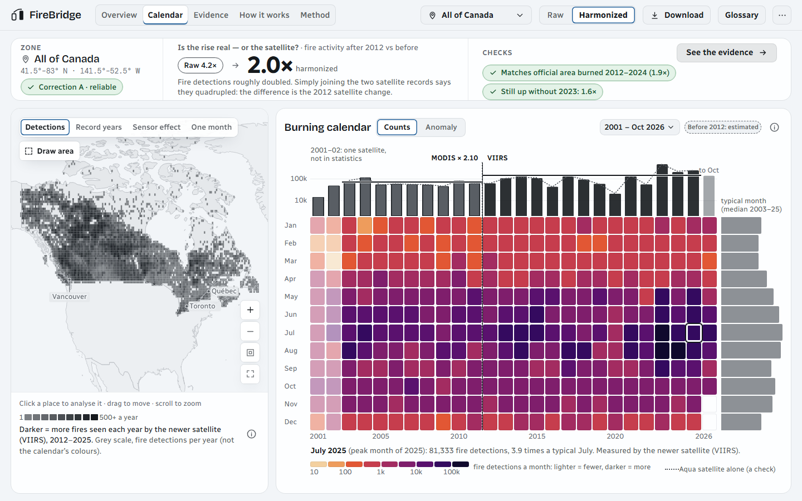
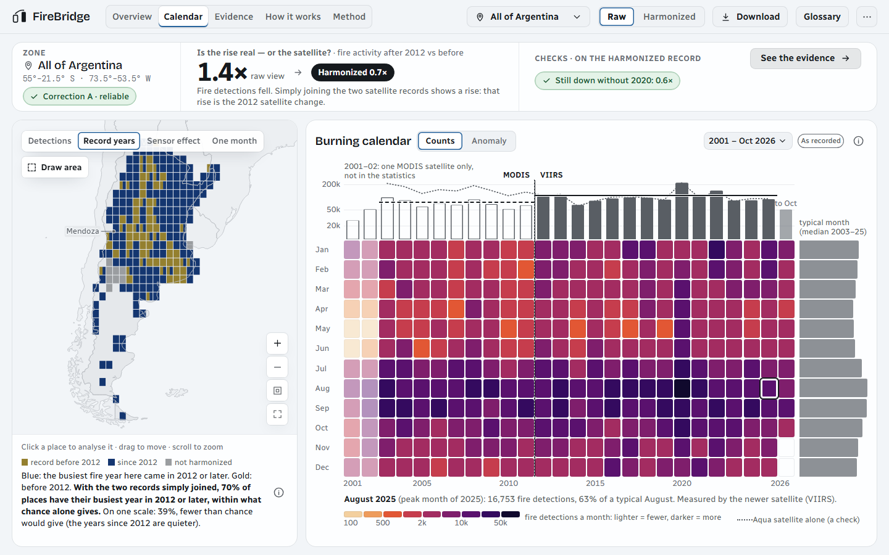
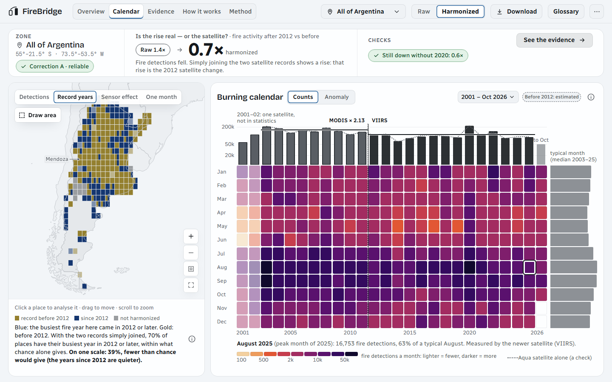

# FireBridge

**Is the rise in fire activity real, or is it the satellite? FireBridge puts NASA's two fire records, MODIS and
VIIRS, on one scale, so the answer no longer depends on the sensor.**



Since 2012 NASA has watched fires with two sensors. Any record that uses MODIS before 2012 and VIIRS after it jumps
in 2012: VIIRS is sharper and, counted on the same ~1 km grid, records about twice as many fire detections (2.10× in
Canada, 2.13× in Argentina). The jump is partly "more fires" and partly "sharper eyes". FireBridge measures the factor in the years
when both sensors fly, puts the 2001–2011 record on the VIIRS scale (the sensor that continues), and shows a
harmonized burning calendar (months × years) for any area of Canada or Argentina, 2001 to October 2026.

NASA Space Apps Challenge 2026, challenge "Harmonization of MODIS and VIIRS Hot Spots" (challenge author: CONAE),
team BlackCoffeeOnly (Yasmine Lounaci and Mouloud Serir). A hackathon prototype: not a NASA product, not endorsed by NASA.

## Try it

- **Live:** https://mouloud08.github.io/BlackCoffeeOnly-Nasa-Space-Apps/
- **Offline:** download [`dist/firebridge.html`](dist/firebridge.html) and open it in a browser. One file: fonts, data
  and map outlines are embedded, and the page is not allowed to make any network request (`connect-src 'none'`).
- **Demo (30 s):** https://mouloud08.github.io/BlackCoffeeOnly-Nasa-Space-Apps/demo.mp4
- Project page text and video script: [`docs/PROJECT_PAGE.md`](docs/PROJECT_PAGE.md),
  [`docs/VIDEO_SCRIPT.md`](docs/VIDEO_SCRIPT.md).

## The two headline results

Rise = mean year of fire detections 2012–2025 against 2003–2011 (a fire detection is a spot where a satellite saw a
fire).

| Zone | VIIRS ÷ MODIS | Records simply joined | Harmonized | Independent check of the trend |
|---|---|---|---|---|
| All of Canada | 2.10 | 4.23× | **2.01×** | Official area burned 1.92×, harmonized 1.88× (same years, 2012–2024) |
| All of Argentina | 2.13 | 1.45× | **0.68×** (fell) | None yet: the result rests on the MODIS record alone |

In Argentina the sensor change turns a fall into an apparent rise. In Canada the rise holds, but joining the records
doubles it.

**Why not simply use MODIS alone?** For the single before/after figure, MODIS alone gives the same answer, by
construction: the years before 2012 are multiplied by the ratio that links VIIRS to MODIS after 2012, so the ratio
cancels. That equality validates nothing, and the official area-burned check tests the trend, not the correction. The
harmonized record gives what MODIS alone cannot: a month-by-month calendar and month ranks on the
scale of the sensor that continues, so the record does not break when MODIS stops. The correction itself is tested on
the overlap years (each year predicted from the others: median error 3% in both countries).

| Records simply joined ("Raw") | Harmonized |
|---|---|
|  |  |

Argentina, "Record years" layer: blue = the busiest year of that place is 2012 or later, sand = before 2012. On one
scale, 223 places move to "before 2012"; none move the other way.

## What the jury can check in two minutes

Clicks from the first screen (Overview). Tabs: **Overview**, **Calendar**, **Evidence**, **How it works**, **Method**;
a **Glossary** button explains the words used on the page.

| Challenge requirement | Where in the app | Clicks |
|---|---|---|
| Harmonized MODIS + VIIRS | Harmonized by default; the **Raw \| Harmonized** switch (keys R / H) flips map, calendar and numbers together | 0 (1 to compare) |
| Burning calendar, months × years | **Calendar** tab | 1 |
| Region by map | **Calendar** → click a place (2° box), or **Draw area**, or move / resize the box; map layers **Detections**, **Record years**, **Sensor effect**, **One month** | 2 |
| Region by coordinates | Zone picker → **Enter coordinates…** | 2 + typing |
| Date range | **Calendar** → date-range button above the calendar | 2 |
| Downloads, incl. hotspot CSV | **Download** (top bar, every tab on desktop) → **This zone**: series CSV, calendar SVG / PNG, map layer CSV; **Real FIRMS hotspots**: **La Rioja · Aug 2024**, **Boreal Québec · Jun 2023** (real FIRMS points, embedded for these two events), **Another area or period…** (the exact FIRMS request for any other area: the app holds monthly counts, not individual detections) | 2 |
| Accessible colour ramps | Ramps checked for colour blindness and grayscale (`tools/cvd.mjs`); sensors shown by shape (MODIS hollow, VIIRS filled); light and dark themes | 0 |
| Current month vs historical median | **Calendar** → click a month: compared with a typical month (median 2003–2025); **Anomaly** mode; **One month** map layer | 2 |

Direct links:
[Overview, Argentina](https://mouloud08.github.io/BlackCoffeeOnly-Nasa-Space-Apps/#tab=overview&z=argentina) ·
[record-years map, Argentina](https://mouloud08.github.io/BlackCoffeeOnly-Nasa-Space-Apps/#tab=dash&z=argentina&l=rec) ·
[Evidence, Canada](https://mouloud08.github.io/BlackCoffeeOnly-Nasa-Space-Apps/#tab=evidence&z=canada) ·
[How it works, step 4](https://mouloud08.github.io/BlackCoffeeOnly-Nasa-Space-Apps/#tab=how&step=4&z=argentina) ·
[October 2026, Argentina](https://mouloud08.github.io/BlackCoffeeOnly-Nasa-Space-Apps/#tab=dash&z=argentina&m=2026-10).
The same hashes work on the offline file.

## How it works

1. **Count** cell-days: a ~1 km cell with at least one fire detection on a day, summed per month on 0.5° tiles.
2. **Measure the jump**: on the overlap years (2012–2025, both sensors flying), ratio = Σ VIIRS ÷ Σ MODIS for the
   selected area (small areas borrow it from a wider area).
3. **Bridge**: every MODIS month before 2012 × that ratio; VIIRS months stay as measured.
4. **Test**: the correction, by predicting each overlap year from the others (median error 3% in both countries);
   the trend, against official area burned (Canada; a check of the trend, not of the correction), without its
   largest year (Canada 1.62× without 2023; Argentina 0.62× without 2020) and with
   resampled years (90% range: Canada 1.30–2.92, Argentina 0.57–0.82).

The application declines to print a rise when the data do not support one: too few detections before 2012, years too
variable, or sensors too far apart (ratio above 4: "Not harmonized here"). It then shows the correction factor and the
reason. Every figure is computed in the browser by `src/metrics.js`; `node tools/selfcheck.mjs` prints them all.

## Data and sources

- **NASA FIRMS** active-fire detections: MODIS Collection 6.1 (`MCD14ML`, Terra and Aqua), VIIRS 375 m on S-NPP
  (`VNP14IMGT`) and NOAA-20 (`VJ114IMGT`). 2001–2025 come from the FIRMS country yearly files, aggregated to 0.5°
  monthly tiles (`data/canada.json`, `data/argentina.json`). January–October 2026 come from the FIRMS area API,
  fetched on 15 November 2026 (`data/2026/`).
- **Canadian National Forestry Database** (via Environment and Climate Change Canada): area burned by year
  (`data/official/`), the independent check for Canada.
- **Natural Earth** country outlines (map and neighbour-country mask).
- **Real hotspot extracts** (`data/hotspots/`), original FIRMS points, values unchanged, in the Download menu (group **Real FIRMS hotspots**):
  Boreal Québec, June 2023 (`quebec-boreal-2023-06`, box 80°–68° W, 47.5°–52.5° N) and La Rioja, Argentina, August
  2024 (`la-rioja-2024-08`, box 68.5°–66.5° W, 29.8°–28.2° S); MODIS, VIIRS S-NPP and VIIRS NOAA-20. MODIS and VIIRS
  files name two columns differently (`brightness`, `bright_t31` / `bright_ti4`, `bright_ti5`): the header is the
  union of the original column names, and a column a sensor does not have is left empty.

The unit everywhere is the **cell-day**: a ~1 km cell with at least one detection on a day, summed per month.

## Limits

- Detections, not burned area. A cell-day says a fire was seen, not how much burned.
- One VIIRS ÷ MODIS ratio per zone, pooled over whole years. It leaves a seasonal residual (in Canada the March ratio
  is 4.10 against 2.10 pooled); disclosed in the Method tab, not corrected.
- Argentina has no independent check yet: its result rests on the MODIS record alone. Next step: an independent
  series (for example annual burned area from the MODIS MCD64A1 product, or national fire statistics, 2003–2024),
  compared the same way as Canada's official area burned.
- Trends in small zones are often decided by one or two extreme years; the app then says "uncertain" and prints the
  sensor factor instead of a rise. Quality thresholds are heuristics calibrated on Québec.
- Places with a local ratio above 4× (62 in Canada, 27 in Argentina) are not harmonized; causes not investigated.
- VIIRS sees small fires MODIS cannot (4.1% of VIIRS cell-days in Canada, 5.5% in Argentina fall where MODIS saw
  nothing that month); no ratio recovers them.
- 2026 is a partial year: its months are shown in the calendar and the exports but are not used in any annual
  statistic. Months from near-real-time files are marked provisional (not filtered for non-fire sources). Months in
  which S-NPP had an outage are continued on NOAA-20, rescaled to S-NPP, and marked as computed. As recorded in the
  FIRMS availability on 15 November 2026, the S-NPP near-real-time data end on 2 November 2026; the record continues
  on NOAA-20 (NOAA-20 ÷ S-NPP = 1.01 in both countries).
- A few coastal points of neighbouring countries pass the country mask (1:50m outlines); see `NOTES_FOR_UI.md`.

## Rebuild

Node 18 or later.

```sh
npm install                # esbuild, React 18, the Radio Canada font, puppeteer-core and axe-core for the checks
(cd vendor && npm install) # Natural Earth outlines (world-atlas) and topojson-client
node build.mjs             # writes dist/firebridge.html and prints "record ends YYYY-MM"
node tools/selfcheck.mjs   # the metrics table every on-screen figure comes from
node scripts/shoot_readme.mjs   # the images in docs/img/ (1440 × 900, light theme); optional path to another build
```

The checks in `tools/` (`interact.mjs`, `coherence.mjs`, `axe.mjs`, …) drive a headless Chrome; see
`tools/README.md`. `tools/` and `build.mjs` assume Linux paths. On Windows, `node scripts/winport.mjs` generates
patched copies (`tools-win/`, `build-win.mjs`) without touching the originals; use `node build-win.mjs` and
`node tools-win/<check>.mjs`. `scripts/shoot_readme.mjs` runs on both (Chrome path from `CHROME`, else the default
install path).

`dist/firebridge-2025-backup.html` is the earlier build whose record ends in December 2025.

## Updating 2026

Nothing in the application calls the network. New months are fetched once, converted to tiles and embedded at build.

1. Get a FIRMS MAP_KEY and put it in a `.env` file at the root (`FIRMS_MAP_KEY=...`, see `.env.example`). The file is
   git-ignored. Never pass the key on a command line and never commit it.
2. Fetch both countries (the record moves only when both have data):
   ```sh
   node scripts/fetch_firms_2026.mjs --bbox=-141.5,41.5,-52.5,83 --name=canada --sensors=MODIS,VIIRS_SNPP,VIIRS_NOAA20
   node scripts/fetch_firms_2026.mjs --bbox=-73.5,-55,-53.5,-21.5 --name=argentina --sensors=MODIS,VIIRS_SNPP,VIIRS_NOAA20
   ```
   Files go to `data/raw/2026/<name>/` (git-ignored) with a `manifest.json`; an interrupted run can be restarted.
3. Check the raw files day by day: `node scripts/check_raw_2026.mjs data/raw/2026/canada`. The fetch script asks the
   near-real-time source for a window that straddles the last day of the standard product, and loses the standard
   days of that window. Fetch them separately with `--from=... --to=...` under another `--name`, then copy the CSV
   files into the country folder (do not reuse the country `--name`: the manifest's end date would be overwritten).
4. Convert and rebuild:
   ```sh
   node tools/build_2026_tiles.mjs --in=data/raw/2026/canada --country=canada
   node tools/build_2026_tiles.mjs --in=data/raw/2026/argentina --country=argentina
   node build.mjs
   ```
   The record ends at the last complete month common to both countries.
5. Verify: `node tools/selfcheck.mjs` (the 2003–2025 figures must not change), `node tools/test_2026_tiles.mjs`,
   `node tools/continuation.mjs`, `node scripts/check_tiles_2026.mjs canada`, `node scripts/check_borders_2026.mjs canada`,
   then `node tools/interact.mjs` and `node tools/coherence.mjs`.

To return to the December 2025 record, delete `data/2026/*.json` and rebuild.

Hotspot extracts: fetch a small box and a short period with the same script (`--from`, `--to`), then
`node scripts/assemble_hotspots.mjs <raw folder> <from> <to> <name>` writes `data/hotspots/<name>.csv`; rebuild.

## Credits

Team BlackCoffeeOnly: Yasmine Lounaci and Mouloud Serir.

Data: NASA FIRMS (MODIS Collection 6.1, VIIRS 375 m S-NPP and NOAA-20); Canadian National Forestry Database;
Natural Earth. Code: React, esbuild, topojson-client; Radio Canada, Atelier Texte and DM Mono typefaces.

AI assistance: code, data processing, checks and texts (including this README) were written with extensive help from
an AI assistant, directed and reviewed by the team. The application declares it too (Method → About and credits).

## Licence

MIT for the code (see `LICENSE`); the embedded data keep their own terms.
